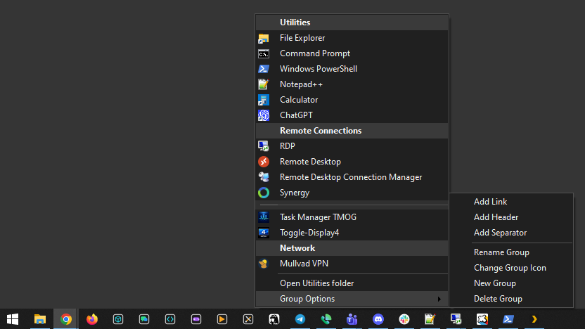
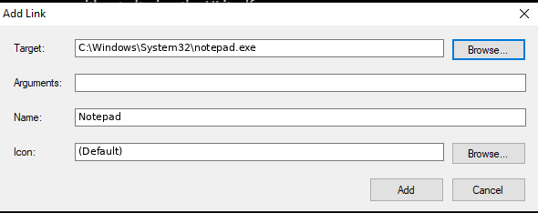
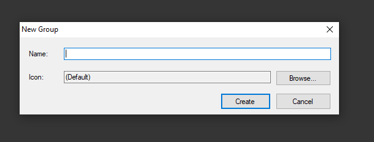
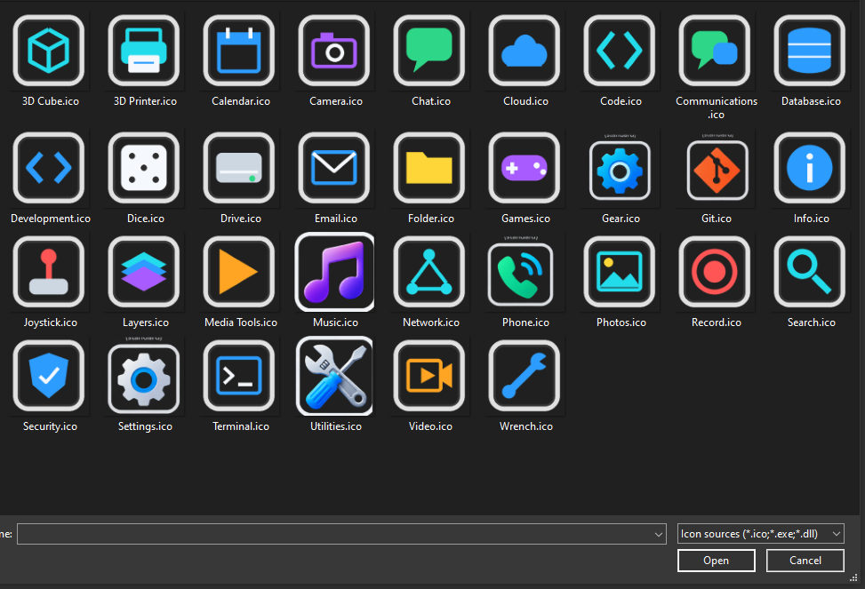
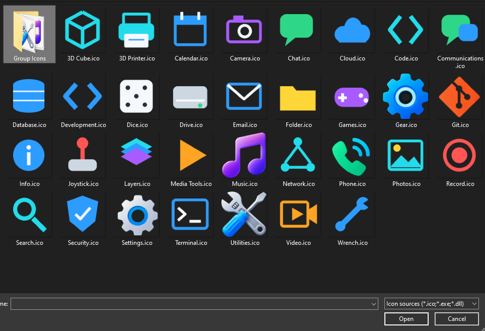

# Taskbar Groups

Taskbar Groups is a lightweight Windows 10 taskbar launcher for user-defined popup groups. Each group is represented by a normal Windows shortcut that can be pinned to the taskbar. Clicking the shortcut asks a small resident host to display the group's menu adjacent to the taskbar click.

The project is deliberately filesystem-driven. Groups, shortcuts, headings, separators, ordering, and icons are ordinary files rather than records in a configuration database.

> **1.0.3 status:** the repository is currently at a known-good pre-release baseline. The persistent host, startup prewarm, menu/icon caches, taskbar positioning, and same-user IPC path are working. One additional feature is planned before the final 1.0.3 release.

## Screenshots

### Group menu



### Adding links



### Creating groups



### Included icon library





## Features

- Multiple independent taskbar groups.
- Normal Windows shortcuts that can be pinned to the taskbar.
- Persistent per-user menu host for low-latency menu opening.
- Startup prewarming of group menus and icon caches.
- In-memory caching of complete `ToolStripItem` menu hierarchies.
- Persistent rendered-icon cache under `%LOCALAPPDATA%\Taskbar-Groups\Cache\MenuIcons`.
- Taskbar-relative menu placement based on the resident host's low-level mouse-down capture and taskbar geometry, so moving the mouse after clicking does not move the popup.
- Supports `.lnk`, `.url`, `.exe`, `.bat`, `.cmd`, and `.ps1` launch items.
- PowerShell 7 is preferred for `.ps1` shortcuts when available; Windows PowerShell 5.1 is the fallback.
- Command-line arguments for created shortcuts.
- Section headings and separators.
- Drag-and-drop ordering with normalized numeric prefixes (`010`, `020`, `030`, ...).
- Per-item commands for moving, inserting, renaming, changing icons, removing items, opening file locations, and opening native Windows property dialogs.
- Group commands for adding items, renaming groups, changing group icons, creating groups, and deleting groups.
- Dark/light appearance follows the Windows app theme.
- Standard and bordered icon libraries included.
- No third-party runtime is required by the launcher.

## How it works

Taskbar shortcuts invoke:

```text
Taskbar-GroupMenu.exe "<Group Name>"
```

At logon, the installer registers:

```text
Taskbar-GroupMenu.exe --resident-host
```

The resident host initializes WinForms once, starts the menu IPC endpoint, prewarms all groups, and remains idle. A later taskbar click starts a short-lived launcher process which forwards the requested group over a same-user named pipe and exits. The resident process then attaches the cached menu hierarchy and displays it.

The host is isolated by both Windows session ID and user SID. The named pipe also has an explicit ACL granting the current user access. This prevents cross-user/session collisions while allowing normal taskbar-launched clients to communicate with the resident host.

See [Architecture](docs/ARCHITECTURE.md) for details.

## Installation

Download and run the release installer:

```text
Taskbar-Groups-Setup-vX.Y.Z.exe
```

Application files are installed under:

```text
C:\Program Files\Taskbar Groups\
├── Taskbar-GroupMenu.exe
├── Icon Library\
└── _templates\
```

Per-user state lives separately under:

```text
%LOCALAPPDATA%\Taskbar-Groups\
├── Groups\
│   └── <Group Name>\
├── Pin to Taskbar\
│   └── <Group Name>.lnk
└── Cache\
    └── MenuIcons\
```

User data is intentionally preserved during uninstall and upgrade.

## Creating and pinning a group

From any existing group, choose:

```text
Group Options
└── New Group
```

Creating a group:

1. Creates `%LOCALAPPDATA%\Taskbar-Groups\Groups\<Group Name>\`.
2. Creates `%LOCALAPPDATA%\Taskbar-Groups\Pin to Taskbar\<Group Name>.lnk`.
3. Configures that shortcut to launch `Taskbar-GroupMenu.exe "<Group Name>"`.
4. Opens Explorer with the shortcut selected so it can be pinned normally.

See the [User Guide](docs/USER-GUIDE.md) for item management, ordering, PowerShell links, headings, separators, and icons.

## Building from source

### Requirements

- Windows 10 or later.
- Windows PowerShell 5.1 or later.
- .NET Framework 4.x with the standard Windows C# compiler (`csc.exe`).
- Inno Setup 6.

Build from the repository root:

```powershell
.\Build-Release.ps1 -Version 1.0.3
```

The version argument is mandatory.

The build script:

1. Stops any existing `Taskbar-GroupMenu` resident process.
2. Compiles `Taskbar-GroupMenu.cs` into `Taskbar-GroupMenu.exe`.
3. Removes Mark-of-the-Web metadata from the packaged payload.
4. Builds `_release\Taskbar-Groups-Setup-v1.0.3.exe` with Inno Setup.
5. Installs the release locally for testing.
6. Stops any stale resident host left by installation/testing.
7. Starts the freshly built host with `--resident-host` through the interactive Windows shell.
8. Gives startup prewarming time to run before returning.

See [Development](docs/DEVELOPMENT.md) for diagnostics and release workflow.

## Performance diagnostics

Set the user environment variable below to enable timestamped performance logs:

```powershell
[Environment]::SetEnvironmentVariable('TASKBAR_GROUPS_PERF', '1', 'User')
```

New processes then write logs such as:

```text
%LOCALAPPDATA%\Taskbar-Groups\performance-20261031-153529-663-43880.log
```

Disable logging with:

```powershell
[Environment]::SetEnvironmentVariable('TASKBAR_GROUPS_PERF', $null, 'User')
```

See [Performance and Caching](docs/PERFORMANCE.md).

## Repository layout

```text
Taskbar-Groups\
├── Taskbar-GroupMenu.cs
├── Build-Release.ps1
├── README.md
├── CHANGELOG.md
├── LICENSE
├── Icon Library\
├── _templates\
├── installer\
│   ├── Taskbar-Groups.iss
│   └── Install-UserData.ps1
└── docs\
    ├── ARCHITECTURE.md
    ├── DEVELOPMENT.md
    ├── PERFORMANCE.md
    ├── RELEASE-NOTES-1.0.3.md
    ├── USER-GUIDE.md
    └── screenshots\
```

`installer\Install-UserData.ps1` remains only to prevent older working trees from continuing to use the previous elevated per-user initialization behavior. Current application versions initialize their own `%LOCALAPPDATA%\Taskbar-Groups` state.

## License

Taskbar Groups is released under the MIT License. See [LICENSE](LICENSE).
