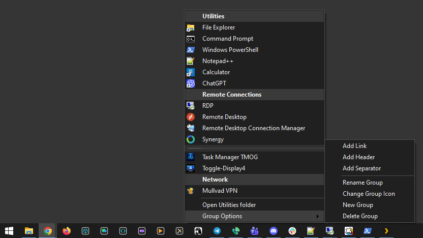
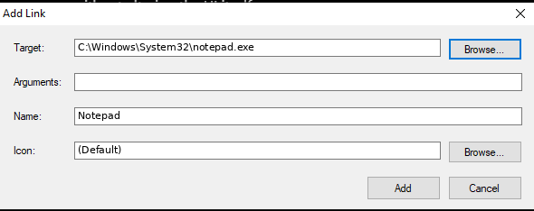
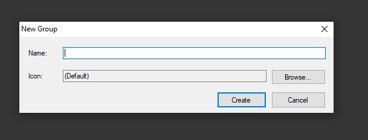
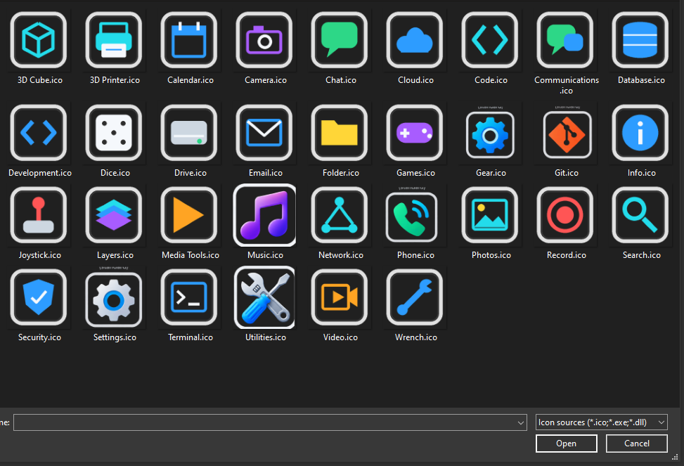
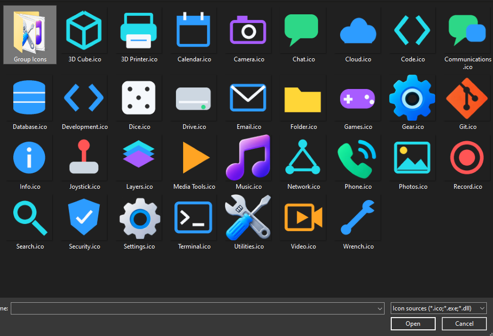

# Taskbar Groups

Taskbar Groups is a lightweight Windows taskbar launcher that provides user-defined popup groups from pinned taskbar icons.

Each group appears as a normal Windows shortcut that can be pinned to the taskbar. Clicking it launches `Taskbar-GroupMenu.exe` for that group and displays its contents as a compact native WinForms popup menu at the mouse cursor.

The project is intentionally file-system driven: group contents, ordering, headings, separators, icons, and shortcuts are represented by ordinary files rather than a separate configuration database.

## Screenshots

### Group menu and management

Groups can contain normal shortcuts, section headers, and separators. The **Group Options** submenu provides commands for adding and managing group contents.



### Adding links

Links can target applications, files, folders, scripts, or other Windows targets. Optional command-line arguments and a custom icon can also be supplied.



### Creating groups

New groups can be created directly from the launcher and assigned a custom icon.



### Included icon library

The included icon library provides bordered variants intended for taskbar groups. The common border gives group launchers a consistent visual identity and distinguishes them from ordinary pinned applications.



Matching unframed icons are included for normal shortcuts and other uses.



## Features

- Multiple independent taskbar groups.
- Native Windows taskbar shortcuts for launching groups.
- Supports `.lnk`, `.url`, `.exe`, `.bat`, `.cmd`, and `.ps1` group items.
- Supports command-line arguments when creating shortcuts.
- Resolves Windows shortcut icons, including explicit icon resources and executable targets.
- Supports packaged Windows application shortcuts when the `.lnk` was created through the Windows shell.
- Numeric filename prefixes control display order.
- Drag-and-drop reordering automatically normalizes prefixes to `010`, `020`, `030`, and so on.
- Section headings and separators can be inserted between launcher items and reordered with the rest of the group.
- Headers and separators use distinct styling so sections are visually apparent.
- Per-item management commands for moving, inserting, renaming, changing icons, removing items, and opening shortcut/file properties.
- Group-level management commands for adding links, headings, separators, renaming groups, changing group icons, creating groups, and deleting groups.
- Dark/light mode follows the Windows app theme.
- Group menus reopen at the same screen position after management operations.
- Reusable standard and bordered group icon libraries.
- No third-party runtime is required for the launcher.

## Installation

Download the latest `Taskbar-Groups-Setup-vX.Y.Z.exe` from the GitHub Releases page and run it.

The installer places the application under:

```text
C:\Program Files\Taskbar Groups\
├── Taskbar-GroupMenu.exe
├── Icon Library\
│   ├── *.ico
│   └── Group Icons\
│       └── *.ico
└── _templates\
    ├── Section Heading.heading
    └── Spacer.separator
```

Taskbar Groups creates per-user data when it runs:

```text
%LOCALAPPDATA%\Taskbar-Groups\
├── Groups\
│   └── <Group Name>\
└── Pin to Taskbar\
    └── <Group Name>.lnk
```

Application files and user data are deliberately separated. Uninstalling Taskbar Groups does **not** delete `%LOCALAPPDATA%\Taskbar-Groups`, so uninstalling or upgrading the application does not destroy configured groups.

## Creating a group

Open an existing group and choose:

```text
Group Options
└── New Group
```

Enter a name and optionally select an icon. Creating a group:

1. Creates `%LOCALAPPDATA%\Taskbar-Groups\Groups\<Group Name>\`.
2. Creates `%LOCALAPPDATA%\Taskbar-Groups\Pin to Taskbar\<Group Name>.lnk`.
3. Configures the shortcut to launch `Taskbar-GroupMenu.exe "<Group Name>"`.
4. Opens Explorer with the new shortcut selected so it can be pinned to the taskbar.

Once the shortcut is pinned, clicking its taskbar icon opens the group.

## Adding links

At the group level:

```text
Group Options
└── Add Link
```

For a specific insertion point, open an existing item's submenu and choose:

```text
Add Link Below
```

The Add Link dialog supports:

- Target
- Command-line arguments
- Display name
- Optional icon source

The resulting `.lnk` is created in the group's directory with an appropriate numeric ordering prefix.

## Headers and separators

Groups can contain structural rows as well as launchable items.

Use:

```text
Group Options
├── Add Header
└── Add Separator
```

Individual items also provide:

```text
Insert Header Above
Insert Separator Below
```

Headers use `.heading` files and separators use `.separator` files. Both participate in normal ordering and drag-and-drop reordering.

## Ordering and reordering

Items are stored with numeric filename prefixes:

```text
010 - First Item.lnk
020 - Second Item.lnk
030 - Section.heading
040 - Another Item.lnk
050 - Spacer.separator
```

The prefixes define the visual order.

Items, headings, and separators can be dragged directly within the popup menu. After a drop, Taskbar Groups renumbers the group in canonical increments of ten:

```text
010
020
030
040
...
```

This keeps the filesystem order synchronized with the visual order while leaving gaps for manual insertion.

## Item management

Open an item's submenu to access commands such as:

```text
Move Up
Move Down
────────────────────────
Insert Header Above
Insert Separator Below
────────────────────────
Add Link Below
Rename
Change Icon
Remove
────────────────────────
Open File Location
Link Properties
File Properties
```

Commands that do not apply to a particular item type are disabled or omitted.

## Group management

The bottom of every group contains:

```text
Open <Group> folder
Group Options
```

`Group Options` provides:

```text
Add Link
Add Header
Add Separator
────────────────────────
Rename Group
Change Group Icon
New Group
Delete Group
```

Deleting a group removes its group directory and pin-ready shortcut. It does not delete any applications or files targeted by shortcuts inside the group.

## Supported item types

Launchable group items:

```text
.lnk
.url
.exe
.bat
.cmd
.ps1
```

Layout items:

```text
.heading
.separator
```

## Icon library

The installed `Icon Library\` contains reusable `.ico` files.

Standard icons live directly under:

```text
C:\Program Files\Taskbar Groups\Icon Library\
```

Bordered variants designed for taskbar group launchers live under:

```text
C:\Program Files\Taskbar Groups\Icon Library\Group Icons\
```

The bordered set uses a common frame so group launchers remain visually distinct from ordinary pinned applications.

When changing an item or group icon, Taskbar Groups also accepts icons from `.ico`, `.exe`, and `.dll` files.

## Shortcut icon resolution

For `.lnk` files, Taskbar Groups attempts to resolve icons in this order:

1. Explicit `IconLocation` stored in the shortcut, including its resource index.
2. The shortcut's target executable.
3. Windows shell-associated shortcut icon fallback.

Executable and DLL icon resources are extracted through Windows shell/native icon APIs.

## Dark and light themes

Taskbar Groups follows the Windows application theme.

In dark mode it uses a custom WinForms renderer. Light mode uses the standard Windows appearance. Headers and separators receive additional styling so structural rows remain visually distinct from normal launcher items.

## Building from source

### Requirements

- Windows 10 or later.
- Windows PowerShell 5.1 or later.
- .NET Framework 4.x with the standard Windows C# compiler (`csc.exe`).
- Inno Setup 6 for building the distributable installer.

`Taskbar-GroupMenu.cs` is the canonical launcher source.

To build a release from the repository root:

```powershell
.\Build-Release.ps1 -Version 1.0.1
```

`Build-Release.ps1`:

1. Compiles `Taskbar-GroupMenu.cs` into `Taskbar-GroupMenu.exe`.
2. Removes Mark of the Web metadata from files being packaged.
3. Invokes Inno Setup.
4. Creates `_release\Taskbar-Groups-Setup-v1.0.1.exe`.
5. Installs the newly built release locally for testing.

The version number is supplied with `-Version`; use the version you are actually building.

## Repository layout

```text
Taskbar-Groups\
├── Taskbar-GroupMenu.cs
├── Build-Release.ps1
├── README.md
├── LICENSE
├── Icon Library\
│   ├── *.ico
│   └── Group Icons\
│       └── *.ico
├── _templates\
│   ├── Section Heading.heading
│   └── Spacer.separator
├── installer\
│   ├── Taskbar-Groups.iss
│   └── Install-UserData.ps1
└── docs\
    └── screenshots\
```

`installer\Install-UserData.ps1` is retained only to prevent older working trees from continuing to use the previous elevated per-user installation behavior. Current versions initialize `%LOCALAPPDATA%\Taskbar-Groups` from the application itself.

Generated files such as `Taskbar-GroupMenu.exe`, `_release\`, compiler artifacts, temporary files, and ZIP archives are excluded by `.gitignore`.

## License

Taskbar Groups is released under the MIT License. See [LICENSE](LICENSE).
